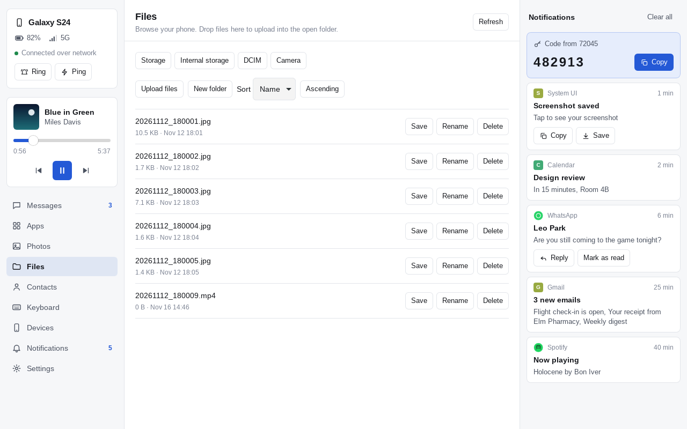
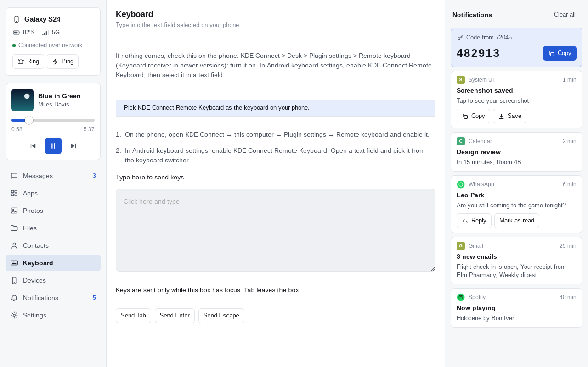
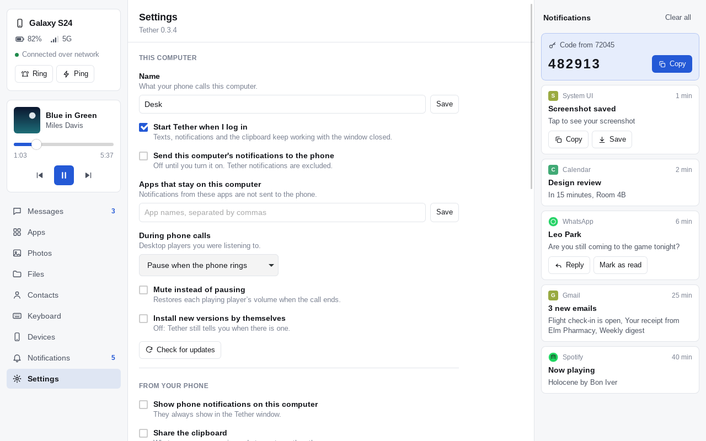
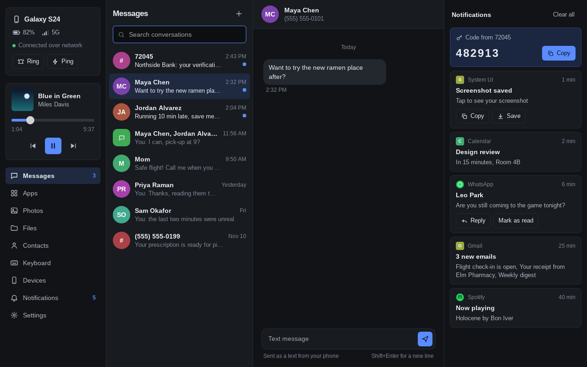
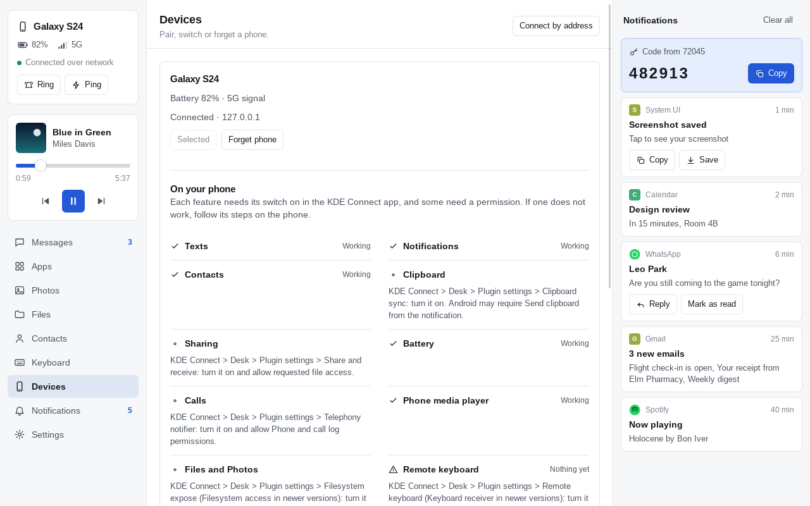

# Tether

Your Android phone, on your Linux desktop. Read and answer texts, see notifications, move files and the
clipboard back and forth, control music on either side, and open your phone's apps in their own windows.
It works on any desktop: GNOME, KDE, Xfce, i3, Sway and the rest.


Tether is a new computer side for the [KDE Connect](https://kdeconnect.kde.org/) protocol. Nothing new goes
on the phone: you keep using the regular **KDE Connect** app from Google Play or F-Droid, and Tether takes
the place of KDE Connect or Valent on the computer.

## What it does

**Texts.** Every conversation from your phone, with names from your contacts, pictures and videos inline,
and full history when you scroll back. Write from the keyboard; a message shows "Sending" until the phone
confirms it went out. One-time codes get a Copy button.

**Notifications.** Phone notifications show up as normal desktop notifications and in a column in the
window. Reply to WhatsApp, Signal and other messaging apps right there, run the notification's own
buttons, or dismiss it on the phone. Screenshot notifications offer Copy and Save for the full picture.
It works the other way too, if you want it: this computer's notifications can go to the phone (off until
you turn it on, with a list of apps to leave out).

**Files.** Drop files anywhere on the window to send them to the phone, with progress. Files, photos,
links and text the phone shares land here: files in your Downloads folder (with Open and Show in folder),
links in your browser, text on your clipboard. The **Files** page browses the phone's storage: open,
save, upload, rename, make folders, delete. The **Photos** page shows your newest camera pictures and
screenshots.

<p>
  
  
</p>

**Clipboard.** Copy text on one, paste it on the other, both ways.

**Music and calls.** What plays on the phone shows in the window with album art, a seek bar and controls,
and on your desktop's media keys and widgets (it appears as a normal MPRIS player). The phone can control
what plays on the computer as well. When a call comes in, the computer pauses (or mutes) what it was
playing and picks it up again after.

**Your phone as a remote for this computer.** From the KDE Connect app you can use the phone as a
touchpad and keyboard, point at slides in presentation mode, lock the screen, change the volume, and
run commands you set up in Tether's Settings ("Lock and suspend", "Open the music player", anything you
can type in a terminal). Each of these has its own switch.

**Typing on the phone.** The **Keyboard** page sends what you type to the phone, into whatever text box
is open there (pick "KDE Connect Remote Keyboard" as the phone's keyboard first; Tether tells you how).

**Finding things.** Ring your phone from the window when it's lost in the couch. Ring the computer from
the phone. Battery and signal of the phone are always in view, and the computer's battery shows on the phone.

**Phone apps in their own windows.** Open any app from your phone in a window on the computer, with its
sound, or the whole phone screen. Pin an app and it joins your desktop's app menu like any other program.
This uses Android's Wireless debugging and [scrcpy](https://github.com/Genymobile/scrcpy) (the Apps page
can download scrcpy for you). It needs Android 10 or newer; setup is a QR code scan or a six-digit code,
once.

**Contacts.** Search everyone in your phone's contacts and start a text from there.

**Tray icon.** Shows the number of unread conversations, on KDE, GNOME (with the AppIndicator extension),
waybar, polybar and i3bar. The background service keeps everything running when the window is closed.

<p>
  
  
</p>

The window follows your system's light or dark theme, works from the keyboard alone (`Ctrl+K` opens a
command palette for everything), and fits on small screens.

## Install

Download from the [Releases page](../../releases/latest) (x86_64):

- **Ubuntu, Debian, Mint, Pop!_OS**: the `.deb`. Open it, or `sudo apt install ./Tether_*.deb`.
- **Fedora, openSUSE**: the `.rpm`. `sudo dnf install ./Tether-*.rpm`.
- **Anything else**: the `.AppImage`. `chmod +x Tether_*.AppImage`, then run it.
- **No admin rights**: the `.tar.gz`. Unpack it and run `./install.sh` (installs into `~/.local`;
  `./install.sh --remove` takes it out again). It needs WebKitGTK 4.1 from your distribution.

Then open **Tether** from your app menu. From then on it starts by itself when you log in, so the phone
stays linked with the window closed (Settings > Start Tether when I log in).

**Updates** are checked once a day. The AppImage and the no-admin install update themselves and the
window offers a restart; `.deb` and `.rpm` installs get an Update button that saves the new package to
Downloads and opens it. Settings > Install new versions by themselves turns the automatic part off.

Quit KDE Connect or Valent first: they use the same network ports. Tether tells you if one is still
running. If you have a firewall, open ports 1714-1764 (TCP and UDP).

## Pair your phone

1. Install KDE Connect on the phone and open it, on the same Wi-Fi as the computer.
2. Open Tether. Your phone appears under "Connect your phone"; click **Pair**.
3. Accept on the phone. Both screens show the same code, so you know it's really your phone.

You can also tap the computer's name in the KDE Connect app and click **Accept** in Tether.

If the phone never shows up (VPNs, guest Wi-Fi and some office networks block discovery), add its address
in Settings > Finding your phone. The address is in the phone's Wi-Fi settings, under the network's
details.

On the phone, each feature has a switch in the KDE Connect app, and some need a permission (notification
access, SMS and contacts, "Filesystem expose" for the Files and Photos pages, "Remote keyboard" for typing
on the phone). Tether's **Devices** page has a checklist: it marks what already works and, for the rest,
says exactly where to tap on the phone.



## Command line

Everything in the window also works from a terminal:

```sh
tether status                         # battery, signal, notifications
tether threads                        # text conversations
tether thread 42                      # one conversation
tether sms --to +15551234567 "On my way"
tether share ~/Pictures/photo.jpg     # a file, or a https:// link
tether clip "some text"               # put text on the phone's clipboard
tether type "hello"                   # type into the phone's open text box
tether ring                           # find your phone
tether media toggle                   # play or pause the phone's music
tether apps spotify                   # open a phone app in its own window
tether watch                          # live events, as JSON lines
```

`tether --help` lists the rest.

## Notes

- Remote input from the phone (touchpad and keyboard) works out of the box on X11. On Wayland, install
  `ydotool`, `wtype` or `dotool`; Tether uses whichever it finds and tells you once if there's none.
- Volume control uses `pactl` (PulseAudio or PipeWire) or `wpctl`.
- Calls themselves still happen on the phone: KDE Connect reports them, it doesn't carry the audio.

## Building from source

Build dependencies (Debian/Ubuntu names): `pkg-config libwebkit2gtk-4.1-dev libgtk-3-dev librsvg2-dev
libsoup-3.0-dev libjavascriptcoregtk-4.1-dev`.

```sh
cargo build --release -p tether -p tether-app
./target/release/tether-app           # the window; it starts the background service itself
```

`tether daemon` runs the background service on its own. Release packages are built by
`.github/workflows/release.yml` when a `v*` tag is pushed.

### Testing without a phone

`crates/tether-core/src/sim` is a stand-in Android phone that speaks the real protocol (TLS, pairing,
every plugin) with made-up texts, contacts, notifications, music and files. `cargo test --workspace` runs
the real background service against it; `testing/ui/wd.sh` drives the real window over WebDriver.
`cargo run -p tether-core --example fake_phone -- 127.0.0.1:1716 /tmp/fake-phone` starts it by hand
(accept it with `tether accept`). More in [docs/testing.md](docs/testing.md).

## How it's put together

- `crates/tether-core`: the protocol (discovery, TLS, pairing, packets, payloads) and the plugins.
- `crates/tether`: the background service, its local API (`$XDG_RUNTIME_DIR/tether/tether.sock`) and the
  command line tool.
- `crates/tether-app` and `ui/`: the window (Tauri on the system's WebKitGTK; plain HTML, CSS and JS).
- `docs/`: protocol notes, design decisions, and how to test each part.

License: GPL-3.0-or-later.
