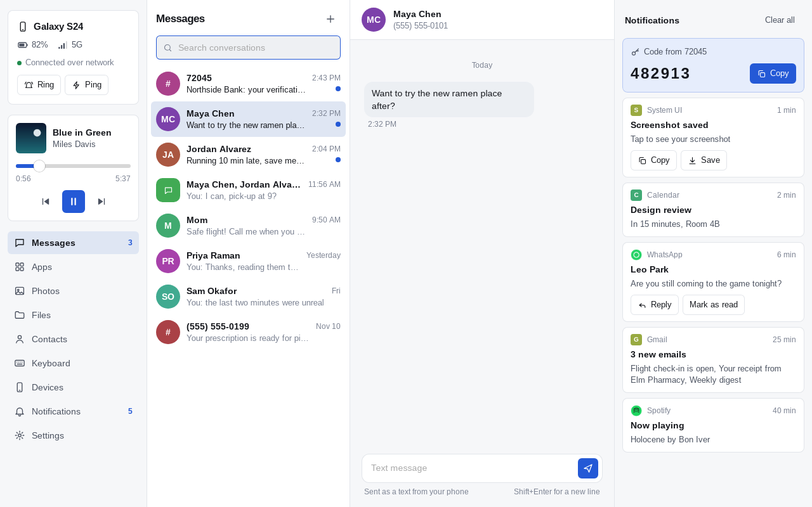

# Tether

Tether connects an Android phone to a Linux desktop. It uses the KDE Connect protocol, so the phone runs
the normal KDE Connect app from Google Play or F-Droid, and Tether replaces KDE Connect or Valent on the
computer. It works on GNOME, KDE, Xfce, i3, Sway and other desktops.



## Features

- Read and send texts, including picture messages, with names from the phone's contacts.
- Phone notifications on the desktop. Reply to messaging apps, use the notification's buttons, or
  dismiss it on the phone. Optionally send the computer's notifications to the phone.
- Send files and links to the phone by dropping them on the window. Files shared from the phone go to
  your Downloads folder, links open in the browser, and text goes to the clipboard.
- Browse the phone's storage (Files page) and its newest photos and screenshots (Photos page).
- Take a photo with the phone's camera from the computer (KDE Connect Android apps that still offer it).
- Clipboard sync for text, both ways.
- Control the phone's music from the window or the desktop's media keys, and control the computer's
  music from the phone. Music on the computer pauses during calls.
- From the phone: use it as a touchpad and keyboard or a presentation remote, lock the screen, change the
  volume, ring the computer, and run commands you set up in Settings.
- Type on the phone from the computer's keyboard (Keyboard page).
- Ring the phone to find it. See its battery and signal.
- Open phone apps in their own windows with scrcpy (Android 10 or newer, Wireless debugging).
- Search contacts and start a text from them.
- Tray icon with the number of unread conversations.
- A checklist on the Devices page of what to turn on in the KDE Connect app.

## Install

Download a package from the [Releases page](../../releases/latest) (x86_64):

- Ubuntu, Debian, Mint, Pop!_OS: `sudo apt install ./Tether_*.deb`
- Fedora, openSUSE: `sudo dnf install ./Tether-*.rpm`
- Other distributions: `chmod +x Tether_*.AppImage` and run it.
- Without admin rights: unpack the `.tar.gz` and run `./install.sh` (installs into `~/.local`;
  `./install.sh --remove` uninstalls). This needs WebKitGTK 4.1 from your distribution.

Open Tether from the app menu. It starts at login from then on; you can turn that off in Settings.
Tether checks for updates once a day. The AppImage and the `.tar.gz` install update themselves; for
`.deb` and `.rpm` the window offers to download the new package.

## Pairing

1. Install KDE Connect on the phone and open it. The phone and computer must be on the same network.
2. Open Tether and click Pair next to your phone.
3. Accept on the phone. Both screens show the same code.

Then open the Devices page in Tether. It lists each feature and what to enable for it in the KDE Connect
app (for example notification access, SMS and contacts permissions, or "Filesystem expose" for the Files
page).

## Command line

```sh
tether status                         # battery, signal, notifications
tether threads                        # list conversations
tether sms --to +15551234567 "On my way"
tether share ~/Pictures/photo.jpg     # send a file or a link
tether clip "some text"               # set the phone's clipboard
tether type "hello"                   # type into the phone
tether ring                           # ring the phone
tether media toggle                   # play or pause the phone's music
tether apps spotify                   # open a phone app in a window
```

Run `tether --help` for the full list.

## Troubleshooting

If the phone doesn't show up, quit KDE Connect or Valent on the computer, since they use the same ports.
With a firewall, open ports 1714-1764 (TCP and UDP). On a VPN, guest Wi-Fi or a network that blocks
discovery, add the phone's IP address in Settings > Finding your phone.

If a feature does nothing, check the Devices page. Its switch or permission is probably off in the KDE
Connect app. On Samsung phones, also set Settings > Apps > KDE Connect > Battery > Unrestricted.

Remote input from the phone works on X11 without extra tools. On Wayland, install `ydotool`, `wtype` or
`dotool`. Volume control from the phone needs `pactl` (PulseAudio or PipeWire) or `wpctl`.

Calls are only reported. The audio stays on the phone.

## Building

Build dependencies (Debian/Ubuntu package names): `pkg-config libwebkit2gtk-4.1-dev libgtk-3-dev
librsvg2-dev libsoup-3.0-dev libjavascriptcoregtk-4.1-dev`.

```sh
cargo build --release -p tether -p tether-app
./target/release/tether-app
```

`cargo test --workspace` runs the background service against a simulated phone
(`crates/tether-core/src/sim`). `testing/ui/wd.sh` tests the window over WebDriver. See
[docs/testing.md](docs/testing.md) for details. Release packages are built by
`.github/workflows/release.yml` when a `v*` tag is pushed.

Code layout: `crates/tether-core` (protocol and plugins), `crates/tether` (background service, local API
and command line tool), `crates/tether-app` and `ui/` (the window, Tauri with the system WebKitGTK),
`docs/` (protocol notes and design decisions).

## License

GPL-3.0-or-later.
